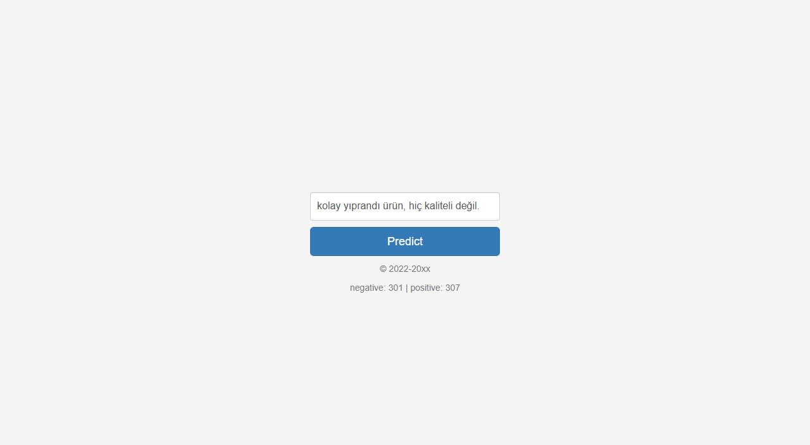
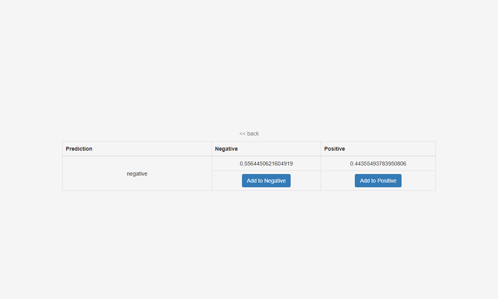

# Turkish Sentiment Analysis




A small Flask app that predicts whether Turkish text is positive or negative. Text processing is built into the model.

The dataset and trained model are not included. Use a dataset you have permission to use at `data/dataset.csv`.

## Requirements

- Python 3.12
- [uv](https://docs.astral.sh/uv/)

## Setup and training

Install the project dependencies:

```sh
uv sync
```

Train the model from `data/dataset.csv`:

```sh
uv run python sentiment_analysis.py
```

Training creates `models/model.keras` and `reports/graphic.jpeg`.

## Run the app

```sh
uv run python app.py
```

Open the URL shown in the terminal. The result page lets you correct a label. Corrections go to `instance/feedback.csv`; they do not change the training data.

## Dataset

`data/dataset.csv` must contain two columns:

| Column | Values |
| --- | --- |
| `text` | Turkish text to classify |
| `sentiment` | `negative` or `positive` |

The model was trained on a small dataset, so its predictions may be wrong.

## Publishing

MIT covers the source code only. The dataset and model are not included or covered by this license.